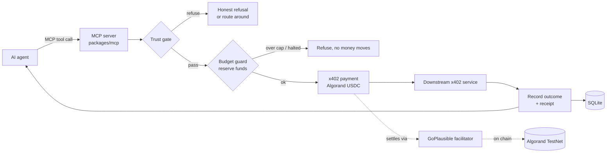
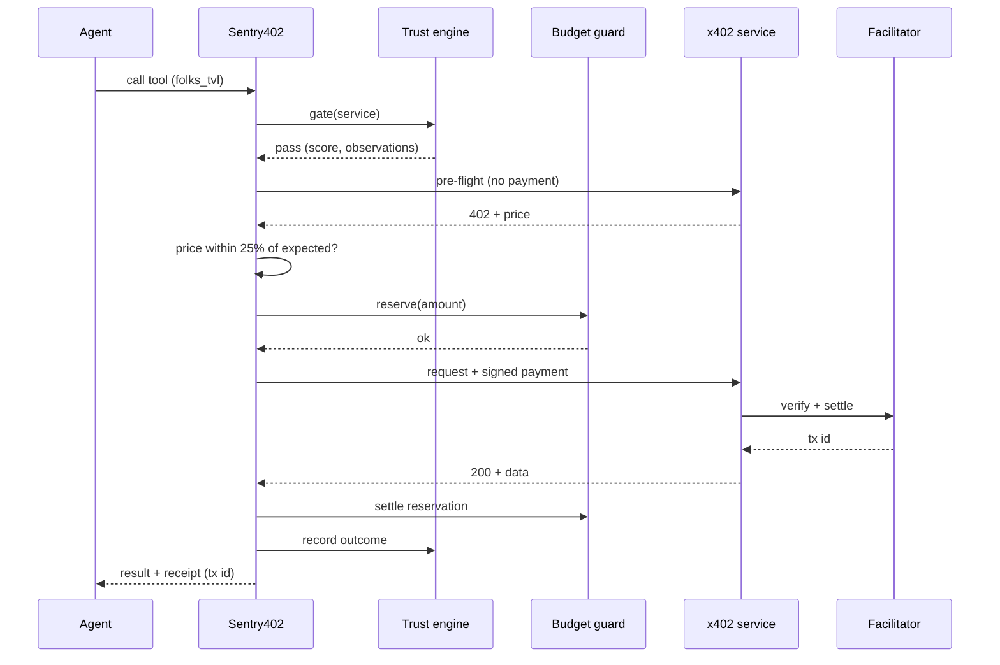
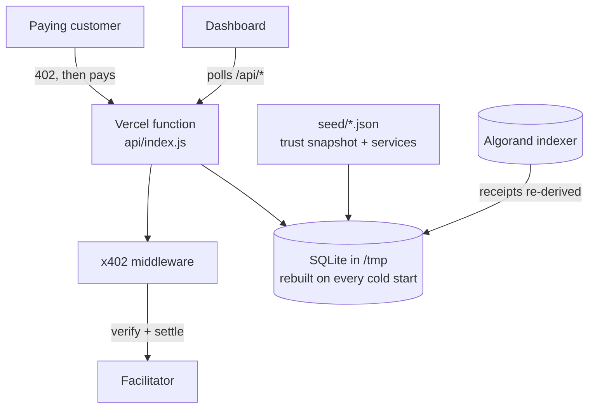

# Sentry402: what it is, how it is built, how to test it by hand

## What it is, in one paragraph

AI agents can now pay for APIs with **x402** (HTTP 402 plus a stablecoin payment). Sentry402 sits between
an agent and those services and does three jobs an agent cannot safely do alone:

1. **Checks a service before paying it**, using a trust record built from real paid calls.
2. **Enforces a spending budget** so a runaway agent cannot drain the wallet.
3. **Pays and returns the result with a receipt**, and sells that same trust record as a paid endpoint.

It is an entry to the Algorand Global x402 Challenge (Orchestrator track), running on Algorand TestNet with
TestNet USDC.

## Where it is used

| Who | How they use it |
| --- | --- |
| An AI agent (Claude, Cursor, etc.) | Installs the **MCP server**. Each x402 service becomes a tool; the agent calls it and Sentry402 checks, budgets and pays |
| Any x402 client or agent | Pays `POST /v1/orchestrate` ($0.05) to route a request, or `GET /v1/trust?url=` ($0.02) for a trust record |
| The operator (you) | Watches the **dashboard**, sets budgets, hits the kill switch, reads reconciliation |
| A judge | Reads the verification panel, which checks every claim against the facilitator live |

## Diagram 1: the system



## Diagram 2: one paid call, step by step



## Diagram 3: what the hosted server does (Vercel)



The hosted server holds **no private key**. It only sells the two routes and serves the site. Outbound payments
come from the operator's own machine.

## Structure

```
api/index.js            Vercel entry: boots the app, rebuilds state, exports the handler
apps/web/               React + Vite dashboard and landing page
packages/shared/        Config, network constants (TestNet/MainNet switch)
packages/api/src/
  app.ts, x402.ts       HTTP app, paywall, paid routes, Bazaar discovery
  payer.ts              Outbound payments: trust gate, budget, price check, route-around
  budget.ts             Reserve/settle/release, per-call/day/merchant caps, kill switch
  trust.ts              Scoring, cold-start exclusion, parole, alternatives
  reconcile.ts          Chain vs records, both directions, refunds and funding
  rehydrate.ts, sync.ts Rebuild state on a stateless host
  inject.ts             Deliberately broken endpoints for failure testing (TestNet only)
  verification.ts       Live proof panel, checked against the facilitator
packages/mcp/           MCP server (stdio)
scripts/                settle-inbound, e2e-testnet, prober, reconcile, kill-switch, accounts
seed/                   Real trust observations and the service registry
```

## Manual test: do this yourself, in order

Use TestNet only. The site is <https://sentry402-ecru.vercel.app>.

1. **See the 402.** `curl -i -X POST https://sentry402-ecru.vercel.app/v1/orchestrate -d "{}"`
   Expect `HTTP 402` and a long `Payment-Required` header.
2. **Endpoint check.** `npm run check:endpoint -- https://sentry402-ecru.vercel.app/v1/orchestrate`
   Expect `12/12 checks passed`.
3. **Doctor.** Open <https://facilitator.goplausible.xyz/guide>, paste the URL above, method POST.
   Expect `BAZAAR: listed` and `HACKATHON: counted`.
4. **Dashboard.** Open the site. Expect the flow graph, receipts, the proof panel and `STREAM POLLING`.
5. **Paid trust record.** `npm run e2e:testnet` step 3 pays $0.02 from a throwaway TestNet account and
   checks the customer's USDC dropped by exactly 0.02.
6. **A real paid call through MCP.** Same script, step 6, drives the MCP server over stdio and pays a real
   downstream service.
7. **Kill switch.** `npm run kill-switch -- on`, ask the MCP tool `folks_tvl` for data (it must refuse), then
   `npm run kill-switch -- off`.
8. **Reconcile.** `npm run reconcile`. Expect `clean`.
9. **Everything at once.** `npm run e2e:testnet -- https://sentry402-ecru.vercel.app`
   Expect `9/9 passed` and a report in `docs/e2e-testnet-report.md`.

## What is and is not proven

Proven on TestNet: paid routes, catalogued by the Bazaar, Doctor badges, real settlements, replay refusal,
budget guard, kill switch, reconciliation.

Not proven, and not claimed: MainNet operation, volume from independent customers, route-around against a
real equivalent service (no two curated services are equivalent).
